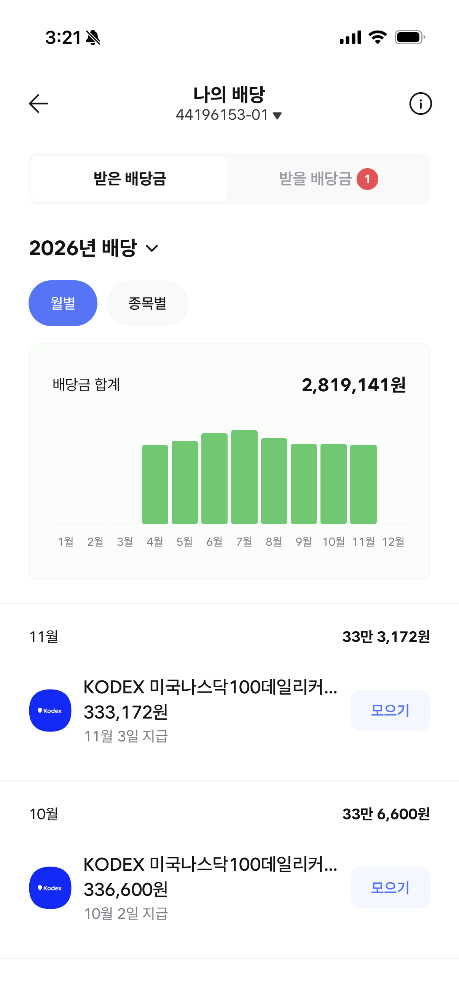

{: .photo-frame}

11월 배당이 들어왔다.

11월 3일 지급, 보유 2,282주에 주당 146원. 333,172원이다. 10월(336,600원)보다 3,428원 줄었다. 주수는 2,244주에서 2,282주로 38주 늘었는데 단가가 150원에서 146원으로 떨어졌다. 주수를 쌓아도 단가가 내려가면 총액은 오히려 줄어든다. 2026년 누적 배당금은 2,819,141원.

그런데 오늘 계좌를 열어보니 다른 숫자가 눈에 들어왔다. -4,008,785원. -17.83%. 매입한 원금에서 400만 원이 넘게 빠져 있다. 배당으로 이미 280만 원을 받았다고 해도 아직 120만 원 넘게 손해다. 단순 계산이지만 마음 어딘가가 묵직해지는 숫자다. 이 투자가 맞는 건지 의심이 드는 건 이번이 처음이 아니다. 7월에 단가가 170원대에서 꺾이기 시작할 때도 그랬고, 8월에 35만 원대로 내려왔을 때도 그랬다. 그때마다 수량이 답이라고 되뇌며 재투자를 이어왔다. 그런데 -17.83%는 조금 다른 무게로 다가온다.

솔직히 말하면 흔들린다. 배당금이 들어오는데 원금은 깎이고 있다는 게 눈에 보이니까. 이게 맞는 방향인지, 아니면 그냥 손실을 배당금으로 포장하고 있는 건지. 커버드콜 ETF 특성상 주가 상승을 포기하는 대신 배당을 받는 구조라는 걸 안다. 머리로는. 근데 막상 -17.83%를 보고 있으면 그 설명이 위로가 되지 않는다. 그래도 지금 팔 생각은 없다. 단가는 내가 정하는 게 아니다. 시장이 정한다. 내가 할 수 있는 건 주수를 쌓는 것뿐이고, 그 원칙 하나를 바꾸면 지금까지 재투자해온 의미가 없어진다. 주가가 낮은 지금, 같은 돈으로 더 많은 주수를 살 수 있다는 것도 사실이다. 2,282주가 2,300주, 2,500주가 되는 날을 목표로 계속 쌓아간다.

333,172원은 전액 재투자한다.
