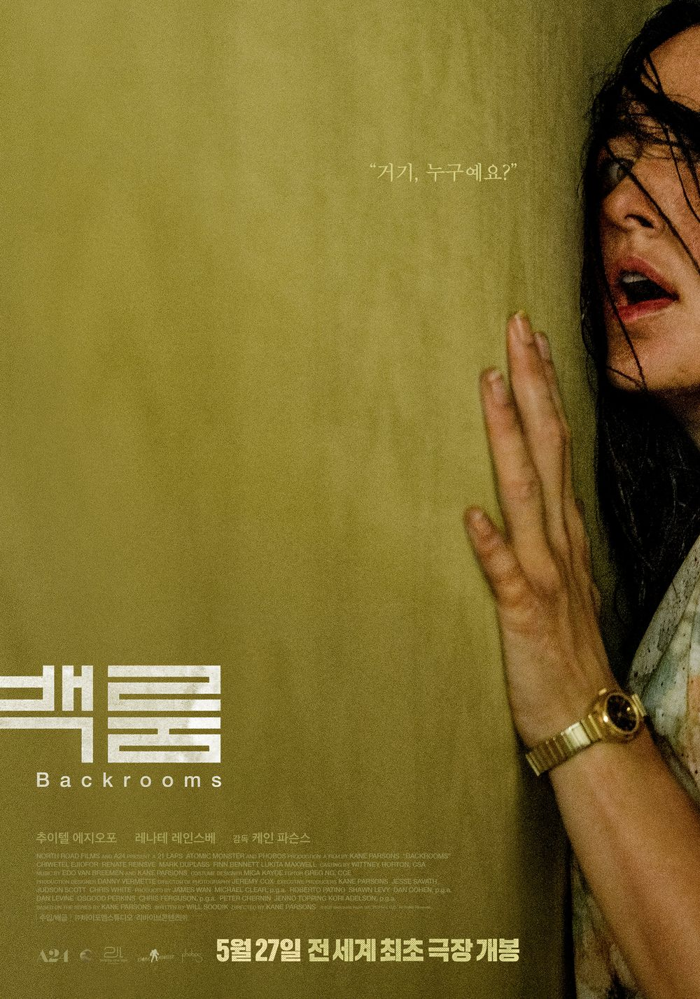

인간은 누구나 현실의 무게를 잠시 벗어던지고 싶다는 허황된 소망 하나쯤 품고 산다. 지난주 사놓고 잊고 있던 로또 용지를 꺼내어 5등에 당첨된 걸 확인했을 때도 그랬다. 고작 5천 원짜리 당첨금이라 일상의 굴레를 끊어낼 수 없다는 건 잘 알지만, "숫자 몇 개만 더 맞췄다면 어땠을까" 하며 헛된 상상의 나래를 펴는 스스로를 보았다. 감당하기 힘든 현실이 찾아올 때, 지금의 판을 한 번에 리셋해 줄 기적을 꿈꾸는 건 본능에 가깝다. 영화 《백룸》을 보며 자연스럽게 고전 소설 《원숭이 손》이 떠오른 이유다. 소원은 이루어지되 가장 비틀린 방식으로 대가를 치르게 된다는 그 서늘한 이야기 말이다.

영화 속 주인공 클락의 삶은 빚더미 가구점, 알코올 중독, 깨진 가정처럼 손쓸 수 없는 실패로 얼룩져 있다. 그에게 현실은 자신이 어떻게 통제할 수조차 없는 수치심의 총체다. 그런 그가 우연히 발을 들인 백룸은 역설적으로 현실의 스트레스와 타인의 평가가 단칼에 차단되는 완벽한 아지트처럼 작동한다. 끝없이 이어지는 노란 벽지와 형광등 소음 속에서 지도를 그리고 구조를 기록하며, 그는 현실에서 단 한 번도 쥐어보지 못한 '이 공간을 내가 지배하고 있다'는 뒤틀린 해방감을 느낀다. 나만의 통제권을 쥐고자 하는 도피 심리가 기묘한 공간의 형태로 구현된 셈이다.

그러나 백룸은 결코 무해한 안식처가 아니다. 그곳은 들어온 사람의 무의식과 숨기고 싶은 트라우마를 스캔해 실제 물리적인 형상으로 베껴내는 거대한 거울에 가깝다. 클락이 현실에서 외면하고 억눌러온 자기혐오와 실패의 기억은 백룸을 만나 비현실적으로 거대해진 기괴한 해적 괴물로 실체화된다. "나를 이 지옥 같은 현실에서 꺼내어 내가 주인이 되는 공간을 달라"는 그의 도피적 소원에 대해, 백룸은 그가 가장 숨기고 싶었던 열등감을 몬스터로 만들어 그 자신을 삼켜버리는 방식으로 대가를 치르게 한다.

영화가 끝난 뒤 남는 묵직한 불편함은 바로 이 질문에서 나온다. 현실의 압박을 피해 도망친 그곳이 과연 진정한 안식처일 수 있는지, 아니면 내가 방치해 둔 어두운 자아가 만들어낸 가장 완벽한 감옥인지 묻고 있기 때문이다. 로또 5등 당첨이라는 사소한 계기에도 슬그머니 도피를 꿈꾸는 나에게, 백룸은 간절히 원했던 소원이 비틀려 현실이 되었을 때 치러야 할 대가가 무엇인지를 나직하게 반문하고 있다.
